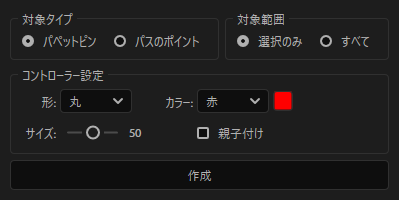
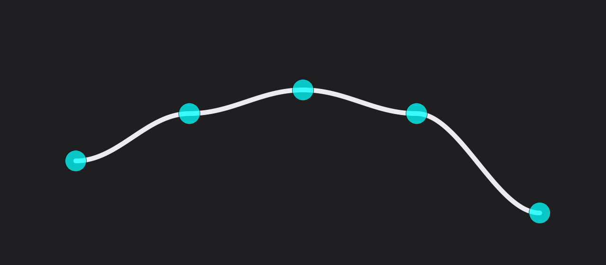

# PinControl

[English](README.md) | 日本語

PinControl は、Adobe After Effects の**パペットピン**と**シェイプのパスのポイント**に、操作用のシェイプレイヤー（コントローラー）を作成する ScriptUI パネルです。コントローラーを動かすと、ピンや頂点がそれに追従します。パネルはドッキングして使えます。

## 機能

- **パペットピン**: 位置ピン・詳細ピン・ベンドピンに対応します。詳細ピンとベンドピンは、スケールと回転もリンクします。
- **パスのポイント**: シェイプレイヤーの各パスの頂点ごとにコントローラーを作成します。トランスフォームを設定したシェイプグループ内のパスにも対応します。
- **対象範囲**: エフェクトコントロールパネルで選択したピン、またはタイムラインで選択したパスだけを対象にできます。レイヤー内のすべてを対象にすることもできます。
- **親子付け**: オンにすると、コントローラーを順番に親子付けします。最初のピン／ポイントが一番上の親になります。
- **コントローラーの見た目**: 丸・四角、8色（ラベルカラーも連動）、サイズを選べます。各コントローラーには「Size」「Color」「Opacity」エフェクトが付くので、作成後も調整できます。
- コントローラーはガイドレイヤーなので、レンダリングされません。
- UI は After Effects の言語設定に合わせて英語・日本語で表示されます。
- 前回の設定を記憶します。

## 動作環境

- Adobe After Effects（After Effects 2026 / Windows で動作確認）

## インストール

1. [`PinControl.jsx`](PinControl.jsx) をダウンロードします。
2. ScriptUI Panels フォルダーにコピーします。
   - Windows: `C:\Program Files\Adobe\Adobe After Effects <バージョン>\Support Files\Scripts\ScriptUI Panels`
   - macOS: `/Applications/Adobe After Effects <バージョン>/Scripts/ScriptUI Panels`
3. After Effects を再起動し、**ウィンドウ > PinControl.jsx** から開きます。ほかのパネルと同じようにドッキングできます。

インストールせずに試す場合は、**ファイル > スクリプト > スクリプトファイルを実行...** から実行します。この場合はフローティングウィンドウで開きます。

## 使い方

### パペットピン

1. パペットエフェクトが適用されたレイヤーを選択します。
2. **パペットピン** を選びます。**選択のみ** の場合は、先にエフェクトコントロールパネルでピンを選択しておきます。
3. **作成** をクリックします。

### パスのポイント

1. シェイプレイヤーを選択します。**選択のみ** の場合は、先にタイムラインでパス（またはそれを含むシェイプグループ）を選択しておきます。
2. **パスのポイント** を選びます。
3. **作成** をクリックします。

あとはコントローラーを動かしてアニメーションを付けます。1回の実行は1回の取り消しで元に戻せます。

## 注意事項

- ピンやパスは、コントローラーをレイヤー名で参照しています。コントローラーの名前を変えるとリンクが切れます。もう一度実行すると、重複しない名前で新しいコントローラーが作成されます。
- ピンを打ったときに After Effects が自動で付けるキーフレームは削除します。キーフレームが2つ以上あるピンは、アニメーションをそのまま残します。
- パスのポイントのコントローラーを削除すると、その頂点は元の位置に戻ります。
- パスのポイントでは、シェイプグループの歪曲（スキュー）は考慮しません。

## ライセンス

[MIT](LICENSE)
