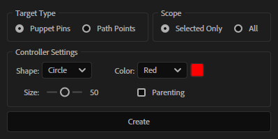

# PinControl

English | [日本語](README.ja.md)

PinControl is a dockable ScriptUI panel for Adobe After Effects that creates shape layer controllers for **puppet pins** and **shape path points**. Move a controller, and the pin or vertex follows.

## Features

- **Puppet pins**: works with Position, Advanced, and Bend pins. Scale and rotation are also linked for Advanced and Bend pins.
- **Path points**: creates one controller per vertex of each path on a shape layer, including paths inside transformed shape groups.
- **Scope**: links only the pins selected in the Effect Controls panel or the paths selected in the Timeline, or everything on the layer.
- **Parenting**: optionally chains the controllers in order, with the first pin or point as the top parent.
- **Controller style**: circle or square, eight colors with matching label colors, and adjustable size. Each controller carries Size, Color, and Opacity effects for later tweaks.
- Controllers are guide layers, so they never render.
- English and Japanese UI, following the After Effects language setting.
- Remembers the settings from the last run.

## Requirements

- Adobe After Effects (tested with After Effects 2026 on Windows)

## Installation

1. Download [`PinControl.jsx`](PinControl.jsx).
2. Copy it to the ScriptUI Panels folder:
   - Windows: `C:\Program Files\Adobe\Adobe After Effects <version>\Support Files\Scripts\ScriptUI Panels`
   - macOS: `/Applications/Adobe After Effects <version>/Scripts/ScriptUI Panels`
3. Restart After Effects and open **Window > PinControl.jsx**. The panel can be docked like any other panel.

To try it without installing, use **File > Scripts > Run Script File...**. The panel then opens as a floating window.

## Usage

### Puppet pins

1. Select a layer that has the Puppet effect.
2. Choose **Puppet Pins**. With **Selected Only**, select the pins in the Effect Controls panel first.
3. Click **Create**.

### Path points

1. Select a shape layer. With **Selected Only**, select the paths (or the shape groups that contain them) in the Timeline first.
2. Choose **Path Points**.
3. Click **Create**.

Move the controllers to animate. Each run is a single undo step.

## Notes

- Pins and paths find their controllers by layer name, so renaming a controller breaks the link. Running PinControl again creates new controllers with unique names.
- The keyframe that After Effects adds when a pin is placed is removed. Pins with two or more keyframes keep their animation.
- Deleting a path point controller returns that vertex to its original position.
- Skew on shape groups is not taken into account for path points.

## License

[MIT](LICENSE)
